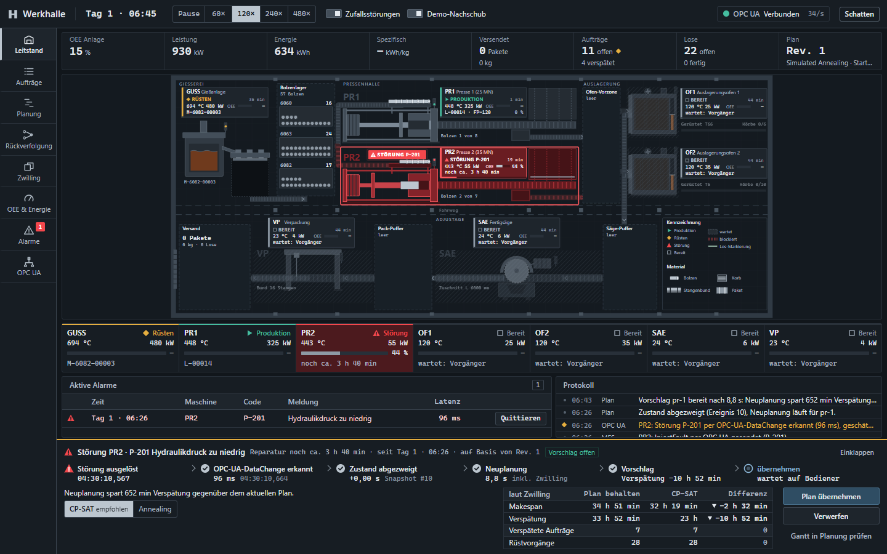
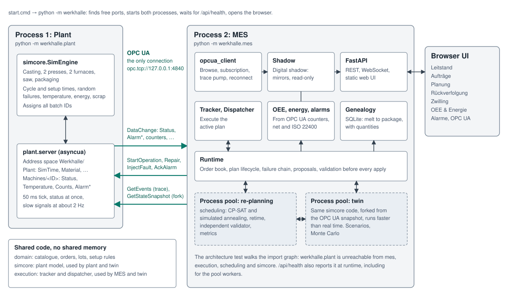
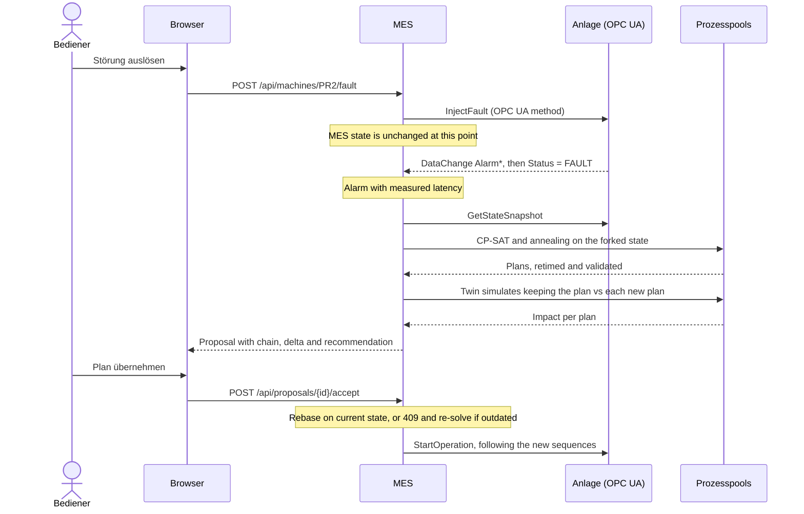

# Werkhalle

A mini smart factory you can run on your laptop: a simulated aluminium extrusion plant behind a real OPC UA server, an
MES that talks to it only over OPC UA, two production schedulers compared side by side, and a digital twin that forks
the live state to test what-if scenarios faster than real time. The UI is in German.



## Start

Requires Windows 11 and Python 3.13. The first start needs internet access and takes a minute or two for the install.

```bash
.\start.cmd
```

This creates `.venv`, installs the dependencies, starts the plant and the MES, then opens the browser at
`http://127.0.0.1:8321/`. If port 8321 or 4840 is taken, it picks the next free one and says so. Stop with Ctrl+C.
Starting it again in the same folder ends the previous instance, and each run starts with a fresh plant.

Useful options, passed straight through `start.cmd`:

| Option | Default | Meaning |
|---|---|---|
| `--time-factor {0,60,120,240,480}` | 120 | Simulated minutes per real minute. At 120, one real second is two minutes |
| `--seed N` | 42 | Seed for the order book and the plant's randomness |
| `--solver-limit S` | 8 | Time limit per solver, in seconds |
| `--no-random-failures` | | Only the failures you trigger yourself |
| `--no-auto-supply` | | No generated orders; the plant goes idle when the orders are done |
| `--http-port N`, `--plant-port N` | 8321, 4840 | Preferred ports |
| `--no-browser` | | Do not open a browser |

## A five-minute tour

1. **Leitstand.** The plant is already running on a start-up plan. Watch billets, baskets and packages move through the hall.
2. **Break a machine.** Click *Presse 2*, then *Störung auslösen*. The machine turns red only once the MES receives the OPC UA
   DataChange, not when you click. The chain at the bottom of the page then shows each step with its real timestamp:
   *Störung ausgelöst → OPC-UA-DataChange erkannt → Zustand geforkt → Neuplanung → Vorschlag → übernehmen*.
3. **Accept or reject.** The proposal compares the current plan with each solver's plan, as simulated by the twin.
4. **OPC UA.** The proof: the browsable address space and the live DataChange feed, with the `Status = FAULT` row highlighted.
5. **Planung.** Press *Neu berechnen* for CP-SAT and Simulated Annealing side by side, with both Gantt charts.
6. **Zwilling.** Run *Presse 2 fällt aus*, *Eilauftrag trifft ein* or both. See the damage and what a new plan gains before
   applying it, and replay the fork in the hall. The live plant is not touched.
7. **Rückverfolgung.** Pick a package to go back to its billets and melt, or a melt to see every package a recall might affect.

To prove the MES has no shortcut, break a machine from outside it, using an independent OPC UA client:

```bash
.venv\Scripts\python.exe tools\break_machine.py PR2 --code P-204 --repair 240 --port 4840
```

## Architecture



The plant and the MES are separate operating-system processes. The MES can reach the plant only through OPC UA:

- **Reading:** subscriptions on variables (status, temperature, counts, alarms, cumulative time counters, material).
- **Acting:** the methods `StartOperation`, `InjectFault`, `Repair`, `AckAlarm`.
- **Traceability:** `EventSeq` notifies, then `GetEvents` pulls, so a coalesced notification cannot lose an event.
- **Forking:** `GetStateSnapshot`, an atomic read used only for planning and the twin, never to refresh the live view.

`tests/test_architecture.py` builds the full import graph and asserts that `werkhalle.plant` is unreachable from `mes`,
`execution`, `scheduling` and `simcore`. `/api/health` also reports it at runtime, including for the pool workers.

### What happens when a machine fails



A proposal is never applied automatically, while rolling replans for new orders are. It is superseded when its machine
recovers, because it would otherwise route around an outage that no longer exists. Another fault or a new order leaves it
open and acceptable while a re-solve runs in the background, and the plant keeps working on the active plan, new lots
included. An undecided proposal expires after 480 sim minutes, unless its fault is still running: then it is re-solved.

### Digital shadow and digital twin

- **Shadow:** one-way. A live mirror of the plant, built from OPC UA subscriptions. It drives the hall, OEE and alarms.
- **Twin:** a fork. It starts from the state read over OPC UA and runs the same `simcore` code as the plant, in another
  process and with no shared memory. The snapshot leaves out the plant's hidden future (true repair times, next failure,
  random state), so the twin cannot predict more than a real one could.

Each scenario runs three variants: **A** current plan undisturbed, **B** current plan with the scenario (the damage), and **C**
a new plan that knows the scenario (the gain). Applying a twin result creates any rush order for real and re-plans from the
live state, without the hypothetical outage. It then arrives as a normal proposal.

## The plant

Aluminium extrusion, with all parameters in [`src/werkhalle/domain/catalog.py`](src/werkhalle/domain/catalog.py):

| Machine | Ideal cycle | Setup | Run power |
|---|---|---|---|
| `GUSS` Gießanlage | 90 min per melt of 24 billets | 45 min on alloy change | 850 kW |
| `PR1` Presse 1, 25 MN | 5.6 to 9 min per billet | 35 min die change, 55 min with alloy change | 325 kW |
| `PR2` Presse 2, 35 MN | 6.8 to 11 min per billet. Only press for `ST-200` and `CB-90` | same | 450 kW |
| `OF1` Auslagerungsofen, 6 baskets | T5 3 h at 200 °C, T66 5 h at 185 °C, T6 6 h at 175 °C | 30 min recipe change | 180 kW |
| `OF2` Auslagerungsofen, 10 baskets | same | same | 260 kW |
| `SAE` Fertigsäge | 0.25 min per bar | 15 min length change | 45 kW |
| `VP` Verpackung | 6 min per package | 10 min package change | 25 kW |

Real durations carry noise and micro-stops. Failures use an MTBF on operating minutes and a lognormal repair time, and
`EstimatedRepairMin` publishes only the estimate. Furnaces are batch machines: lots with the same recipe share a load.

## Scheduling

An order splits into lots, and each lot runs `press → age → saw → pack`. Melts are planned from billet demand minus stock. Both
solvers work on the same problem and minimise the same objective:

```
10 × weighted tardiness + makespan + 2 × setup minutes
```

- **Constraints:** alternative machines and eligibility, sequence-dependent setups including the initial state, furnace capacity in
  baskets, same-recipe batching, transport lags, release times, machine downtime, running operations frozen, billet supply.
- **CP-SAT:** a circuit per machine, with join and next arcs on furnaces, warm-started from the best rule plan.
- **Simulated annealing:** a lot-priority list, machine choices and a wait gene that can hold a furnace load to fill it, with a serial decoder.
- **Arbiter:** `validate_schedule` is independent of both solvers. Each of its rules has a negative test proving the rule can
  fire. Every plan is retimed first, since dispatch starts operations as soon as it can, and a plan that fails validation is never applied.

Execution follows the plan's machine sequences. Planned times are advisory, so a plan stays valid when things run late.

## OEE

Calculated in the MES from cumulative OPC UA counters, in [`mes/oee.py`](src/werkhalle/mes/oee.py):

- `availability = run / planned`, where `planned = run + setup + fault + idle − no_demand`
- `performance = ideal / run`. For a furnace the ideal time is `soak × baskets / capacity`, so a part-filled load shows as lost performance
- `quality = good / total`
- **OEE ISO** follows ISO 22400 and counts waiting for material as an availability loss. In a flow line, that mostly measures how far a
  machine is from the bottleneck, so **OEE netto** also removes starved time and is what the UI leads with. Both are always shown.

## Traceability

The plant assigns the IDs and the MES learns them only from trace events:

```
Schmelze S-… → Bolzen B-… → Strang ST-… → Korb K-… → Paket P-… → Auftrag A-…
                                            └ Ofenladung O-… (side node)
```

Edges carry quantities, so balances can be tested. A furnace load is a side node, because a shared load must not link
unrelated lots: a recall from a melt follows the real material, and only a recall rooted on the load itself returns everything in it.

## Measured

From final runs on the development laptop (20 cores, default settings):

| What | Result |
|---|---|
| Fault to detection over OPC UA, from the Status `SourceTimestamp` | 26 to 96 ms |
| Fault to re-plan proposal, at the default 8 s solver limit | 8.5 to 9.2 s |
| Twin, three variants without the solvers | 2.9 simulated days in 0.1 s, about 2.1 million times real time |
| Browser on the Leitstand for 10 minutes | Stable at about 5 MB heap, 121 fps, no console errors |
| First start from a fresh copy, including `pip install` | About 90 s. Later starts: under 10 s |

The start-up plan leaves about 2 to 4 of the 11 seed orders late, so a re-plan has something to win.

## Tests

```bash
.venv\Scripts\python.exe -m pip install -r requirements-dev.txt
```

```bash
.venv\Scripts\python.exe -m pytest -q
```

Add `-m "not e2e"` to skip the tests that spawn the real processes. The main files:

| File | Covers |
|---|---|
| `test_scheduler_*.py` | Constraints and optima, a negative test per validator rule, random mid-run states |
| `test_oee.py` | Hand-calculated OEE, edge cases, windows |
| `test_simcore*.py` | State tables, conservation of material, fork at every event |
| `test_execution_*.py`, `test_twin.py` | Closed loop without OPC UA, double-start protection, stale plans, scenarios |
| `test_e2e.py` | Real processes, a fault from an independent OPC UA client, detection, proposal, accept |
| `test_architecture.py` | The import rule |

## Limits

This is a demo, and these are deliberate simplifications:

- OPC UA runs without security on `127.0.0.1`, and the HTTP API has no login. Do not expose either to a network.
- Transport is a fixed time lag with no capacity. There are no shifts, operators or material costs.
- An operation that has started stays on its machine and resumes after repair. A re-plan moves only what has not started.
- A run lives in memory and restarting begins a new one. SQLite holds the current run's history.
- `--solver-limit` governs proposals and manual solves. Startup and rolling plans take at most 3 s.
- A random fault shorter than `pipeline_seconds × factor / 60` gets no proposal ("zu kurz für Neuplanung"): about 19 min at
  120× and 76 min at 480× (estimates). One broken through the UI always gets one. At 480× a 240 min repair lasts 30 s, so
  demo at 120×.
- Neither solver always wins. At a few seconds CP-SAT and annealing trade places from one fault state to the next, so treat
  any single run as one sample.
- Bars come from whole billets, so an order can be over-delivered (149 of 140, for example).
- `Spezifisch kWh/kg` is total energy over shipped kg, so it starts high and falls as a run goes on.
- The hall and KPI row show OEE over a rolling 8 h, the OEE tab defaults to since-start, so the two can differ.
- A second instance needs its own `--data-dir` and `--log-dir` (default `data/run-<id>/werkhalle.db`, `logs/plant.log`,
  `logs/mes.log`).

## Layout

```
start.cmd                 One-command start
src/werkhalle/
  __main__.py             Launcher
  domain/                 Catalogue, orders, shared planning state
  simcore/                Discrete-event plant model, used by plant and twin
  plant/                  OPC UA server
  scheduling/             Problem builder, CP-SAT, annealing, retime, validator, metrics
  execution/              Tracker, dispatcher, rebase, shared by MES and twin
  mes/                    OPC UA client, shadow, OEE, trace, twin, runtime, API
  web/                    UI: static ES modules, no build step, no external requests
tools/                    break_machine.py, mock_mes.py (UI dev server)
docs/                     PLAN.md (design and contracts), API.md (HTTP and WebSocket)
```
